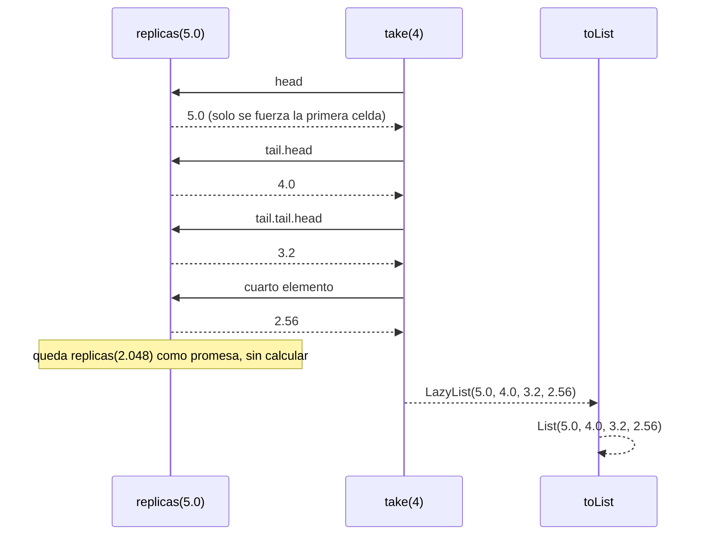

# Informe de proceso — Consultas sobre un registro sísmico

Taller 3. Fundamentos de Programación Funcional y Concurrente.
Escuela de Ingeniería de Sistemas y Computación, Universidad del Valle.

Este informe explica cómo se ejecuta cada función de
`app/src/main/scala/taller/RegistroSismico.scala`, en qué operaciones
(`map`, `flatMap`, `filter`) se traduce cada expresión `for` usada y por qué
la secuencia perezosa del punto 4 no agota la memoria aunque sea infinita.

Todo el código usa `val`, recursión y llamados a funciones: no hay `var`,
`while`, `return` ni `for` imperativo.

## 0. El registro de ejemplo

Los ejemplos usan el registro entregado en el material (`Datos.registro`),
siete sismos en este orden:

| # | Fecha | Región | Magnitud | Profundidad |
|---|---|---|---|---|
| 1 | 2025-03 | Valle | 4.2 | 30 |
| 2 | 2025-03 | Santander | 5.1 | 150 |
| 3 | 2025-04 | Valle | 3.8 | 25 |
| 4 | 2025-04 | Choco | 6.0 | 40 |
| 5 | 2025-05 | Santander | 4.7 | 160 |
| 6 | 2025-05 | Valle | 5.3 | 35 |
| 7 | 2025-06 | Choco | 3.1 | 20 |

El orden importa: varias funciones conservan el orden de aparición de las
regiones, que es Valle, Santander, Choco.

## 1. Cómo una expresión `for` se traduce

Una expresión `for` con `yield` no es un ciclo: es azúcar sintáctica que el
compilador reescribe con `map`, `flatMap` y `filter` sobre la colección
recorrida. Las reglas que se aplican en este taller son:

- `x <- c` seguido de `yield e` se traduce en `c.map(x => e)`.
- Una guarda `if p` se traduce en un `withFilter(p)` que descarta los elementos
  que no cumplen la condición.
- Dos generadores `x <- c1` e `y <- c2` se traducen en `c1.flatMap(x => c2.map(y => ...))`.
- Un generador con patrón, como `a :: resto <- lista`, descarta con
  `withFilter` los elementos que no encajan con el patrón.

Por eso `for` produce siempre una colección nueva y no muta nada. Esta tabla
resume la traducción de las expresiones `for` del taller, y las secciones
siguientes las detallan una por una:

| Función | Expresión `for` | Se traduce en |
|---|---|---|
| `fuertes` | `s <- r; if s.magnitud > umbral` | `r.withFilter(...).map(...)` |
| `enRegion` | `s <- r; if s.region == region` | `r.withFilter(...).map(...)` |
| `paresCercanos` (regiones) | `s <- r` | `r.map(...)` |
| `paresCercanos` (parejas) | `a :: resto <- regiones.tails; b <- resto; if cercanas(a, b)` | `regiones.tails.withFilter(...).flatMap(...)` |
| `porRegion` (externo) | `r1 <- r` | `r.map(...)` |
| `porRegion` (interno) | `r2 <- r; if r1.region == r2.region` | `r.withFilter(...).map(...)` |
| `conteoPorRegion` (externo) | `s1 <- r` | `r.map(...)` |
| `conteoPorRegion` (interno) | `s2 <- r; if s2.region == s1.region` | `r.withFilter(...).map(...).size` |
| `magnitudMaxima` (externo) | `s1 <- r` | `r.map(...)` |
| `magnitudMaxima` (interno) | `s2 <- r; if s2.region == s1.region` | `r.withFilter(...).map(...).max` |
| `maximaDe` | `s <- r; if s.region == region` | `r.withFilter(...).map(...).maxOption` |
| `regionMasActiva` | `(region, n) <- regiones; if regiones.forall(...)` | `regiones.withFilter(...).map(...)` |
| `informe` | `(region, n) <- conteos` | `conteos.map(...)` |

`conteoSeguro`, `replicas` y `replicasSensibles` no usan `for`: reutilizan
otras funciones y aplican `withDefaultValue`, `LazyList.iterate`+`map` y
`takeWhile` respectivamente. Por eso no aparecen en la tabla.

## 2. Punto 1: consultas con expresiones `for`

### 2.0 Notación

Para hablar de las listas de sismos se usa la notación inductiva de listas: una
lista es la lista vacía, $\text{List}()$, o un elemento al frente de otra lista,
$s :: l$.

$$
\text{List}() \quad \text{y} \quad s :: l
$$

De ella se desprenden las definiciones de las operaciones que el compilador usa
para traducir un `for`. `map` aplica una función a cada elemento y conserva el
orden y la longitud:

$$
\text{List}().\text{map}(f) = \text{List}()
$$

$$
(s :: l).\text{map}(f) = f(s) :: l.\text{map}(f)
$$

`withFilter` (la traducción de la guarda `if p`) conserva solo los elementos que
cumplen la condición $p$:

$$
\text{List}().\text{withFilter}(p) = \text{List}()
$$

$$
(s :: l).\text{withFilter}(p) =
  \begin{cases}
    s :: l.\text{withFilter}(p) & \text{si } p(s) \\
    l.\text{withFilter}(p) & \text{si no}
  \end{cases}
$$

Por lo tanto, `for { s <- l; if p(s) } yield f(s)` se ejecuta como
$l.\text{withFilter}(p).\text{map}(f)$, cuyas dos definiciones permiten seguir
el recorrido paso a paso: una guarda por elemento y una aplicación de $f$ por
elemento que sobrevive.

### 2.1 `fuertes`

```scala
def fuertes(r: Registro, umbral: Double): List[String] =
  for {
    s <- r
    if s.magnitud > umbral
  } yield s.region
```

**Traducción del `for`:** equivale a

```scala
r.withFilter(s => s.magnitud > umbral).map(s => s.region)
```

**Especificación.** Si $R$ es el registro y $u$ el umbral, la función calcula

$$
\text{fuertes}(R, u) = \langle\, s.\text{region} \mid s \in R \;\land\; s.\text{magnitud} > u \,\rangle
$$

donde $\langle\, f(s) \mid p(s) \,\rangle$, la notación de conjuntos de Z,
significa "la lista de los $f(s)$, en el orden de recorrido de $R$, para los
$s$ que cumplen $p$". La comparación es estricta: $s.\text{magnitud} > u$ y no
$\geq$.

Ejecución paso a paso sobre el registro con `umbral = 5.0`. `withFilter`
no copia la lista: guarda la condición y se aplica a medida que `map` recorre.
Cada sismo se prueba una sola vez, en orden:

| # | Sismo | $5.0 < s.\text{magnitud}$ | Resultado parcial |
|---|---|---|---|
| 1 | Valle 4.2 | falso | |
| 2 | Santander 5.1 | verdadero | $\text{List}(\text{Santander})$ |
| 3 | Valle 3.8 | falso | |
| 4 | Choco 6.0 | verdadero | $\text{List}(\text{Santander}, \text{Choco})$ |
| 5 | Santander 4.7 | falso | |
| 6 | Valle 5.3 | verdadero | $\text{List}(\text{Santander}, \text{Choco}, \text{Valle})$ |
| 7 | Choco 3.1 | falso | |

La tabla sigue la definición recursiva del filtrado: en cada paso se decide si
el primer sismo pasa la guarda y se continúa con el resto. Formalmente, la
traza de los primeros pasos es

$$
\text{fuertes}(R, 5.0) \rightarrow R.\text{withFilter}(p).\text{map}(\text{region})
$$

$$
\rightarrow \text{List}(\text{Valle } 4.2, \ldots).\text{withFilter}(p).\text{map}(\text{region})
$$

$$
\rightarrow \text{List}(\text{Santander } 5.1, \ldots).\text{withFilter}(p).\text{map}(\text{region})
$$

$$
\rightarrow \text{List}(\text{Santander}) ++ \text{List}(\text{Choco } 6.0, \ldots).\text{withFilter}(p).\text{map}(\text{region})
$$

donde $p(s) \equiv s.\text{magnitud} > 5.0$. Al terminar el recorrido, el
$++$ acumula cada región que pasó la guarda.

Devuelve `List("Santander", "Choco", "Valle")`. Como no se usa `distinct`,
se conservan los repetidos, y la comparación es estricta (`>`): con
`umbral = 6.0`, el sismo de magnitud exactamente 6.0 queda por fuera, porque
$6.0 > 6.0$ es falso. Con `r = List()` el `map` no recorre nada y devuelve
`List()`.

### 2.2 `enRegion`

```scala
def enRegion(r: Registro, region: String): List[Double] =
  for {
    s <- r
    if s.region == region
  } yield s.magnitud
```

**Traducción del `for`:** `r.withFilter(s => s.region == region).map(s => s.magnitud)`.

**Especificación.** Para un registro $R$ y una región $g$:

$$
\text{enRegion}(R, g) = \langle\, s.\text{magnitud} \mid s \in R \;\land\; s.\text{region} = g \,\rangle
$$

**Ejecución paso a paso** con `region = "Valle"` y $p(s) \equiv s.\text{region} = \text{"Valle"}$:

| # | Sismo | $p(s)$ | Resultado parcial |
|---|---|---|---|
| 1 | Valle 4.2 | verdadero | $\text{List}(4.2)$ |
| 2 | Santander 5.1 | falso | $\text{List}(4.2)$ |
| 3 | Valle 3.8 | verdadero | $\text{List}(4.2, 3.8)$ |
| 4 | Choco 6.0 | falso | $\text{List}(4.2, 3.8)$ |
| 5 | Santander 4.7 | falso | $\text{List}(4.2, 3.8)$ |
| 6 | Valle 5.3 | verdadero | $\text{List}(4.2, 3.8, 5.3)$ |
| 7 | Choco 3.1 | falso | $\text{List}(4.2, 3.8, 5.3)$ |

En notación recursiva, el último paso es

$$
\text{List}(\text{Choco } 3.1).\text{withFilter}(p).\text{map}(\text{magnitud}) = \text{List}()
$$

porque $p(\text{Choco } 3.1)$ es falso y el resto de la lista es vacío. Así se
llega a `List(4.2, 3.8, 5.3)`. Si la región no aparece en ningún sismo,
ninguno pasa la guarda y el recorrido termina en $\text{List}()$, que es el
caso base de `withFilter`.

### 2.3 `paresCercanos`

```scala
def paresCercanos(r: Registro, dif: Double): List[(String, String)] = {
  val regiones: List[String] =
    (for { s <- r } yield s.region).distinct

  def cercanas(a: String, b: String): Boolean =
    enRegion(r, a).exists(ma => enRegion(r, b).exists(mb => Math.abs(ma - mb) <= dif))

  (for {
    a :: resto <- regiones.tails
    b <- resto
    if cercanas(a, b)
  } yield (a, b)).toList
}
```

El problema pide cada pareja una sola vez, sin importar el orden, y con las
regiones en orden de aparición. La función resuelve eso en tres pasos.

**Especificación.** Si $g_1, g_2, \ldots, g_k$ son las regiones en orden de
aparición y $D = \{\, s.\text{magnitud} \mid s \in R \;\land\; s.\text{region} = g \,\}$
es el conjunto de magnitudes de la región $g$, entonces

$$
\text{paresCercanos}(R, d) = \langle\, (g_i, g_j) \mid 1 \leq i < j \leq k \;\land\;
\exists\, m \in D_{g_i},\, m' \in D_{g_j} : |m - m'| \leq d \,\rangle
$$

La condición $i < j$ es la que cumple las dos exigencias del enunciado a la vez:
impide $i = j$ (una región no se empareja consigo misma) y fija el orden de la
pareja, de modo que $(g_j, g_i)$ no vuelve a aparecer después de $(g_i, g_j)$.
La condición de cercanía usa $\leq$ y no $<$, así que una diferencia
exactamente igual a $d$ cuenta, y como se usan cuantificadores existenciales,
basta con que haya **un** par de magnitudes cercanas.

**Paso 1 — las regiones, en orden y sin repetir.** El primer `for` se traduce
en `r.map(s => s.region)` y luego `.distinct` elimina repetidos conservando la
primera aparición. Sobre el registro da `List("Valle", "Santander", "Choco")`.
En notación formal, la lista $(g_1, g_2, g_3)$ con $g_1 = \text{Valle}$,
$g_2 = \text{Santander}$ y $g_3 = \text{Choco}$.

**Paso 2 — la condición `cercanas`.** Aquí no hay `for`: se usa `exists`, que
recorre la lista y se detiene en la primera magnitud que satisface la
condición. `cercanas(a, b)` pregunta si existe alguna magnitud de `a` y alguna
magnitud de `b` cuya diferencia absoluta no supere `dif`:

$$
\text{cercanas}(a, b, d) \equiv \exists\, m \in D_a,\; m' \in D_b : |m - m'| \leq d
$$

Para $a = \text{Valle}$ y $b = \text{Santander}$: $D_a = \{4.2, 3.8, 5.3\}$ y
$D_b = \{5.1, 4.7\}$. Con $d = 0.6$, el primer par que cumple es $m = 5.3$ y
$m' = 5.1$, cuya diferencia es $|5.3 - 5.1| = 0.2 \leq 0.6$, así que
`cercanas` responde `true` sin probar el resto.

**Paso 3 — las parejas sin repetir.** `regiones.tails` produce la lista de
todos los sufijos:

$$
\text{List}(g_1, g_2, g_3),\quad \text{List}(g_2, g_3),\quad \text{List}(g_3),\quad \text{List}()
$$

El patrón `a :: resto <-` toma la cabeza de cada sufijo y descarta el sufijo
vacío (no encaja con el patrón). Así, `a` recorre cada región una vez, y
`resto` contiene solo las regiones posteriores a `a`:

- con $a = g_1 = \text{Valle}$, $\text{resto} = \text{List}(g_2, g_3)$;
- con $a = g_2 = \text{Santander}$, $\text{resto} = \text{List}(g_3)$;
- con $a = g_3 = \text{Choco}$, $\text{resto} = \text{List}()$.

El `for` completo se traduce en

```scala
regiones.tails
  .withFilter { case a :: resto => true; case _ => false }
  .flatMap { case a :: resto => resto.withFilter(b => cercanas(a, b)).map(b => (a, b)) }
```

donde el `flatMap` une las parejas de un mismo `a` con las de los siguientes,
y el `.toList` final convierte el resultado en lista.

**Ejecución paso a paso** con `dif = 1.0`. La columna central muestra los
primeros pares de magnitudes $m \in D_a$, $m' \in D_b$ que se prueban con
$|m - m'|$:

| $a$ | $b$ | $\lvert m - m' \rvert$ probadas | $\leq 1.0$ | Pareja acumulada |
|---|---|---|---|---|
| Valle | Santander | $\lvert 4.2 - 5.1 \rvert = 0.9$ | sí | $(g_1, g_2)$ |
| Valle | Choco | $\lvert 4.2 - 6.0 \rvert = 1.8$, $\lvert 4.2 - 3.1 \rvert = 1.1$, $\lvert 3.8 - 6.0 \rvert = 2.2$, $\lvert 3.8 - 3.1 \rvert = 0.7$ | sí (en el cuarto par) | $(g_1, g_2), (g_1, g_3)$ |
| Santander | Choco | $\lvert 5.1 - 6.0 \rvert = 0.9$ | sí | $(g_1, g_2), (g_1, g_3), (g_2, g_3)$ |
| Choco | — | no hay `resto` | — | fin |

Devuelve `List(("Valle", "Santander"), ("Valle", "Choco"), ("Santander", "Choco"))`.
Con `dif = 0.1` ninguna pareja se acerca lo suficiente, porque el par más
próximo es $|5.3 - 5.1| = 0.2 > 0.1$, y devuelve `List()`.

## 3. Punto 2: agrupar con mapas

Las tres funciones siguen el mismo esquema: recorrer el registro y, para cada
región, construir el resumen mirando otra vez el registro. El `for` externo
produce pares $g \mapsto v$ y `.toMap` los convierte en un `Map[String, X]`.

**Cómo se ejecuta `toMap`.** Si la lista de pares es
$\text{List}(k_1 \mapsto v_1, k_2 \mapsto v_2, \ldots)$, `toMap` inserta los
pares de izquierda a derecha; cuando una clave se repite, el valor que queda es
el **último** insertado:

$$
\text{toMap}\left(\text{List}(k \mapsto v_1, k \mapsto v_2)\right) = \{k \mapsto v_2\}
$$

En estas tres funciones eso no cambia el resultado: para una misma región $g$,
el par $g \mapsto v$ se calcula siempre con la misma regla a partir del mismo
registro, así que todos los valores calculados para $g$ son iguales entre sí.
Es lo que permite decir, en el informe de corrección, que el resultado no
depende del orden de recorrido.

Las funciones que se usan para definir los agrupamientos son:

$$
\text{porRegion}(R) = \text{toMap}\left(
  \langle\, g_r \mapsto \langle\, s \mid s \in R \land s.\text{region} = g_r \,\rangle \mid r \in R \,\rangle
\right)
$$

$$
\text{conteoPorRegion}(R) = \text{toMap}\left(
  \langle\, g_r \mapsto \left|\langle\, s \mid s \in R \land s.\text{region} = g_r \,\rangle\right| \mid r \in R \,\rangle
\right)
$$

$$
\text{magnitudMaxima}(R) = \text{toMap}\left(
  \langle\, g_r \mapsto \max\langle\, s.\text{magnitud} \mid s \in R \land s.\text{region} = g_r \,\rangle \mid r \in R \,\rangle
\right)
$$

donde $g_r$ es $r.\text{region}$ y $\left|\ell\right|$ es la longitud de la
lista $\ell$. Las tres funciones no toman listas prestadas de otro sitio:
se construyen con `toMap`, que es lo que la rúbrica exige para los
agrupamientos.

### 3.1 `porRegion`

```scala
def porRegion(r: Registro): Map[String, List[Sismo]] = {
  (for {
    r1 <- r
  } yield r1.region -> (for {
    r2 <- r
    if r1.region == r2.region
  } yield r2)).toMap
}
```

**Traducción de los `for`:** el externo es
`r.map(r1 => r1.region -> (...))`; el interno es
`r.withFilter(r2 => r1.region == r2.region).map(r2 => r2)`.

**Ejecución paso a paso.** Para cada $r_1$ del registro se calcula el par
$g_{r_1} \mapsto \text{enRegion de } g_{r_1}$:

| # | $r_1$ | $g_{r_1}$ | Valor calculado por el `for` interno |
|---|---|---|---|
| 1 | Valle 4.2 | Valle | $\text{List}(\text{Valle } 4.2, \text{Valle } 3.8, \text{Valle } 5.3)$ |
| 2 | Santander 5.1 | Santander | $\text{List}(\text{Santander } 5.1, \text{Santander } 4.7)$ |
| 3 | Valle 3.8 | Valle | la misma lista del paso 1 |
| 4 | Choco 6.0 | Choco | $\text{List}(\text{Choco } 6.0, \text{Choco } 3.1)$ |
| 5 | Santander 4.7 | Santander | la misma lista del paso 2 |
| 6 | Valle 5.3 | Valle | la misma lista del paso 1 |
| 7 | Choco 3.1 | Choco | la misma lista del paso 4 |

La lista de pares tiene siete entradas y tres claves distintas; `toMap` deja
tres claves y conserva, para Valle, el par del paso 6, que es idéntico al del
paso 1. El resultado reparte los siete sismos en las tres regiones, y dentro de
cada lista se mantiene el orden de aparición en el registro.

### 3.2 `conteoPorRegion`

Es el mismo esquema, con `.size` en lugar de la lista:

```scala
def conteoPorRegion(r: Registro): Map[String, Int] =
  (for {
    s1 <- r
  } yield s1.region -> (for {
    s2 <- r
    if s2.region == s1.region
  } yield s2).size).toMap
```

**Traducción:** el `for` externo es `r.map(s1 => s1.region -> (...).size)`, y
el interno `r.withFilter(s2 => s2.region == s1.region).map(s2 => s2)`. Su
longitud es el número de sismos de la región de $s_1$:

$$
\text{size}\left(\langle\, s_2 \mid s_2 \in R \land s_2.\text{region} = g_{s_1} \,\rangle\right) =
\left|\{s \in R \mid s.\text{region} = g_{s_1}\}\right|
$$

**Ejecución paso a paso:**

| # | $s_1$ | $g_{s_1}$ | Cantidad de sismos de $g_{s_1}$ |
|---|---|---|---|
| 1 | Valle 4.2 | Valle | 3 |
| 2 | Santander 5.1 | Santander | 2 |
| 3 | Valle 3.8 | Valle | 3 |
| 4 | Choco 6.0 | Choco | 2 |
| 5 | Santander 4.7 | Santander | 2 |
| 6 | Valle 5.3 | Valle | 3 |
| 7 | Choco 3.1 | Choco | 2 |

`toMap` deja `Map(Valle -> 3, Santander -> 2, Choco -> 2)`. Con el registro
vacío el `map` externo no produce pares y `toMap` da `Map()`.

### 3.3 `magnitudMaxima`

```scala
def magnitudMaxima(r: Registro): Map[String, Double] =
  (for {
    s1 <- r
  } yield s1.region -> (for {
    s2 <- r
    if s2.region == s1.region
  } yield s2.magnitud).max).toMap
```

**Traducción:** igual que `conteoPorRegion`, pero el `for` interno proyecta
`s2.magnitud` y sobre esa lista se aplica `.max`.

**Ejecución paso a paso.** Para cada región, el `for` interno produce la lista
de magnitudes y `.max` toma la mayor:

| Región | Lista del `for` interno | `.max` |
|---|---|---|
| Valle | $\text{List}(4.2, 3.8, 5.3)$ | $5.3$ |
| Santander | $\text{List}(5.1, 4.7)$ | $5.1$ |
| Choco | $\text{List}(6.0, 3.1)$ | $6.0$ |

Resultado: `Map(Valle -> 5.3, Santander -> 5.1, Choco -> 6.0)`. Las regiones
que no están en el registro no aparecen, porque nunca llegan a ser una $s_1$ y
su lista nunca se construye; por eso `.max` nunca se aplica a una lista vacía,
que lanzaría `UnsupportedOperationException`.

## 4. Punto 3: consultas seguras

El punto pide consultar un mapa sin que lance excepción cuando la clave no
existe: `Map.apply` responde lanzando `NoSuchElementException` sobre una clave
ausente. Las tres funciones evitan ese camino.

### 4.1 `conteoSeguro`

```scala
def conteoSeguro(r: Registro): Map[String, Int] =
  conteoPorRegion(r).withDefaultValue(0)
```

No hay `for`: reutiliza el mapa del punto 2 y le agrega un valor por
defecto. Formalmente, si $M = \text{conteoPorRegion}(R)$, la consulta queda

$$
M.\text{withDefaultValue}(0)(g) =
  \begin{cases}
    M(g) & \text{si } g \in \text{dominio}(M) \\
    0 & \text{si } g \notin \text{dominio}(M)
  \end{cases}
$$

**Ejecución:** el mapa sigue teniendo solo las regiones del registro, así que
`conteoSeguro(registro)("Valle")` consulta la entrada existente y devuelve `3`,
mientras que `conteoSeguro(registro)("Amazonas")` no encuentra la clave y
responde `0` **sin agregarla al mapa**. Con el registro vacío el dominio es
vacío y toda consulta responde `0`.

### 4.2 `maximaDe`

```scala
def maximaDe(r: Registro, region: String): Option[Double] = {
  (for {
    s <- r
    if s.region == region
  } yield s.magnitud).maxOption
}
```

**Traducción:** `r.withFilter(s => s.region == region).map(s => s.magnitud).maxOption`.

**Especificación.** Es el máximo de la lista de magnitudes, envuelto en
`Option` para representar el caso vacío:

$$
\text{maximaDe}(R, g) =
  \begin{cases}
    \text{Some}\left(\max\{s.\text{magnitud} \mid s \in R \land s.\text{region} = g\}\right) & \text{si hay al menos un sismo de } g \\
    \text{None} & \text{si no}
  \end{cases}
$$

**Ejecución:** el `for` construye la misma lista que `enRegion`. Para
`"Choco"` produce $\text{List}(6.0, 3.1)$, y `maxOption` devuelve
`Some(6.0)`. Para `"Amazonas"` produce $\text{List}()$, y `maxOption` devuelve
`None` en lugar de lanzar excepción. `maxOption` es justamente la variante
segura de `max`: la diferencia entre ambas es el caso de la lista vacía.

### 4.3 `regionMasActiva`

```scala
def regionMasActiva(r: Registro): Option[String] = {
  val regiones = conteoSeguro(r)
  (for {
    (region, n) <- regiones
    if regiones.forall { case (otra, m) => m < n || (m == n && region <= otra)
    }
  } yield region).headOption
}
```

**Traducción:** con `regiones` ya calculado, el `for` es
`regiones.withFilter { case (region, n) => regiones.forall(...) }.map { case (region, n) => region }`.

**Especificación.** Con $C = \text{conteoPorRegion}(R)$,

$$
\text{regionMasActiva}(R) = \text{headOption}\left(
  \langle\, g \mid g \in \text{dominio}(C) \land \forall\, g' \in \text{dominio}(C) : C(g') < C(g) \lor (C(g') = C(g) \land g \leq g') \,\rangle
\right)
$$

La condición $C(g') < C(g) \lor \left(C(g') = C(g) \land g \leq g'\right)$ dice,
para cada región candidata $g$, que ninguna otra $g'$ le gana por conteo y que
en caso de empate $g$ no va después alfabéticamente.

**Ejecución paso a paso:**

1. `conteoSeguro(r)` da $C = \{\text{Valle} \mapsto 3, \text{Santander} \mapsto 2, \text{Choco} \mapsto 2\}$.
2. Para $g = \text{Valle}$: con $C(\text{Valle}) = 3$, ninguna otra región tiene
   conteo mayor ($2 < 3$ y $2 < 3$), así que la condición se cumple.
3. Para $g = \text{Santander}$: $C(\text{Valle}) = 3$ no es menor que $2$ ni
   hay empate, así que la condición falla.
4. Para $g = \text{Choco}$: falla por Valle; además, en el empate con Santander,
   $\text{Choco} \leq \text{Santander}$ es falso.
5. Solo sobrevive $\text{Valle}$ y `headOption` da `Some("Valle")`.

Con el registro vacío el dominio es vacío, el `for` no produce nada y
`headOption` da `None`. Con las regiones $\{\text{Zulia} \mapsto 2, \text{Arauca} \mapsto 2\}$,
para Zulia la condición falla porque
$\text{Arauca} \leq \text{Zulia}$ y también hay empate, mientras que para Arauca
se cumple; solo sobrevive `Arauca`.

## 5. Punto 4: réplicas perezosas

### 5.1 `replicas`

```scala
def replicas(magnitud: Double): LazyList[Double] = {
  def redondear(x: Double): Double = Math.round(x * 100.0) / 100.0
  LazyList.iterate(magnitud)(x => x * 0.8).map(redondear)
}
```

**Especificación.** La función describe una secuencia infinita de magnitudes
que empieza en $m$ y multiplica por $0.8$ en cada paso, redondeando cada valor
a dos decimales:

$$
r_0 = m, \qquad r_{n+1} = r_n \cdot 0.8, \qquad \text{replicas}(m) = \left(\text{redondear}(r_0), \text{redondear}(r_1), \ldots\right)
$$

$$
\text{redondear}(x) = \frac{\text{round}(100x)}{100}
$$

donde $\text{round}$ es el redondeo al entero más cercano que implementa
`Math.round`, que es lo que calcula `Math.round(x * 100.0) / 100.0`.

**Cómo se ejecuta.** `LazyList.iterate(inicial)(f)` construye una secuencia
cuya cabeza es el valor inicial y cuya cola es una **promesa** de calcular
$f(\text{inicial})$ más adelante. `map` sobre `LazyList` también es perezoso:
no transforma la secuencia, sino que la envuelve, de modo que aplica
`redondear` a cada elemento en el momento en que alguien lo pide. Aunque aquí no
hay un `for`, la regla es la misma de los puntos anteriores: `.map(f)`
produce una colección nueva; la diferencia es que en una `LazyList` esos
elementos no existen hasta que se piden, que es la traducción de `for` que pide
el criterio de colecciones.

La definición recursiva de la secuencia es:

$$
\text{replicas}(m) = \text{redondear}(m) :: \text{replicas}(m \cdot 0.8)
$$

Es infinita: para cada $n$ existe el elemento $n+1$. Por eso no se puede
materializar completa, pero sí se puede observar por partes.

### 5.2 `replicasSensibles`

```scala
def replicasSensibles(magnitud: Double, minimo: Double): List[Double] =
  replicas(magnitud).takeWhile(_ > minimo).toList
```

**Especificación.** La lista de los elementos de la secuencia que superan el
mínimo, deteniéndose en el primero que no lo supera:

$$
\text{replicasSensibles}(m, \mu) = \left(\text{redondear}(r_0), \ldots, \text{redondear}(r_{k-1})\right), \quad k = \min\{n \mid r_n \leq \mu\}
$$

`takeWhile` pide elementos mientras se cumpla $\text{redondear}(r_n) > \mu$ y
para en el primero que no cumple. Como la comparación es estricta, el
mínimo no entra. Así `replicasSensibles(5.0, 3.0)` es `List(5.0, 4.0, 3.2)` y
`replicasSensibles(2.0, 3.0)` es `List()`, porque el primer elemento ya no
supera el mínimo y `takeWhile` se detiene sin pedir ningún otro.

### 5.3 Por qué una secuencia infinita no agota la memoria

Una `List` se evalúa de golpe: antes de devolverla hay que construir todas sus
celdas, y si es infinita el programa no termina. Una `LazyList` no: cada celda
existe solo cuando alguien la pide, y hasta entonces el resto es una promesa
que no ocupa memoria.

En términos de memoria, si $M(n)$ es la memoria que ocupa la secuencia cuando se
piden $n$ elementos, una lista materializada cumple $M(n) \to \infty$ porque no
hay un $n$ que la complete, mientras que con la secuencia perezosa se tiene

$$
M_{\text{LazyList}}(n) = \Theta(n), \qquad \text{para todo } n \text{ solicitado}
$$

Es decir, la memoria depende de **cuánto se pide** y no de la longitud total de
la secuencia, que no existe. En cambio, para la lista materializada no hay
ningún $n_\text{total}$ finito:

$$
\nexists\, N : \left|\text{replicas}(m)\right| = N
$$

`replicas(5.0)` no cuenta cuántas réplicas hay; solo describe cómo se genera el
siguiente valor. Las celdas se calculan por demanda:

| Elemento pedido | $n$ | Se calcula | Valor |
|---|---|---|---|
| `head` | 0 | $r_0 = 5.0$ | $5.0$ |
| `tail.head` | 1 | $r_1 = r_0 \cdot 0.8$ | $4.0$ |
| `tail.tail.head` | 2 | $r_2 = r_1 \cdot 0.8$ | $3.2$ |
| elemento 4 | 3 | $r_3 = r_2 \cdot 0.8$ | $2.56$ |
| elemento 5 | 4 | $r_4 = r_3 \cdot 0.8$ | $2.05$ |
| elemento 6 | 5 | $r_5 = r_4 \cdot 0.8$ | $1.64$ |

Cada paso aplica `redondear` a dos decimales con `Math.round(x * 100.0) / 100.0`,
como pide el enunciado.

**Traza de `replicas(5.0).take(4).toList`.** `take(4)` pide la cabeza, guarda la
cola como promesa y repite: para devolver cuatro elementos necesita forzar
cuatro celdas y **ninguna más**. El quinto elemento no se calcula, y el sexto
tampoco. La traza, escrita como llamados encadenados, es

$$
\text{replicas}(5.0).\text{take}(4).\text{toList} \rightarrow
\langle 5.0, 4.0, 3.2, 2.56 \rangle
$$

$$
\text{take}(4)\big(\text{replicas}(5.0)\big) \rightarrow 5.0 :: \text{take}(3)\big(\text{replicas}(4.0)\big)
$$

$$
\rightarrow 5.0 :: 4.0 :: \text{take}(2)\big(\text{replicas}(3.2)\big)
$$

$$
\rightarrow 5.0 :: 4.0 :: 3.2 :: \text{take}(1)\big(\text{replicas}(2.56)\big)
$$

$$
\rightarrow 5.0 :: 4.0 :: 3.2 :: 2.56 :: \text{take}(0)\big(\text{replicas}(2.048)\big) \rightarrow \text{List}()
$$

El último paso lo muestra con claridad: cuando `take(0)` recibe la secuencia
que empezaría en $2.048$, no pide ningún elemento, porque ya tiene los
cuatro pedidos. El valor $2.048$ nunca se calcula (y si se calculara, con
`redondear` daría $2.05$). Si la definición no fuera perezosa, `take(4)` tendría
que construir la secuencia completa antes de recortarla, y como la secuencia no
termina, el programa se quedaría calculando para siempre.



Es decir, solo se materializan los elementos pedidos.

## 6. Punto 5: informe combinado

```scala
def informe(r: Registro, minimo: Double): Map[String, Resumen] = {
  val conteos = conteoPorRegion(r)
  val maximas = magnitudMaxima(r)
  (for {
    (region, n) <- conteos
  } yield region -> Resumen(
    n,
    maximas(region),
    replicasSensibles(maximas(region), minimo).length
  )).toMap
}
```

**Traducción del `for`:** con `conteos` ya calculado, el `for` es
`conteos.map { case (region, n) => region -> Resumen(n, maximas(region), replicasSensibles(maximas(region), minimo).length) }`.

**Especificación.** Para cada región $g$ del registro, el resumen combina las
tres cantidades que pide el enunciado:

$$
\text{informe}(R, \mu) = \text{toMap}\left(
  \langle\, g \mapsto \text{Resumen}\left(C(g),\, M(g),\,
    \left|\text{replicasSensibles}(M(g), \mu)\right|\right)
  \mid g \in \text{dominio}(C) \,\rangle
\right)
$$

donde $C = \text{conteoPorRegion}(R)$ y $M = \text{magnitudMaxima}(R)$. Las
réplicas se cuentan sobre la magnitud máxima de la región, y la longitud de
la lista es el número de réplicas sensibles que se esperan.

**Ejecución paso a paso** con `minimo = 3.0`:

1. $C$ = `Map(Valle -> 3, Santander -> 2, Choco -> 2)` (punto 3.2).
2. $M$ = `Map(Valle -> 5.3, Santander -> 5.1, Choco -> 6.0)` (punto 3.3).
3. Para cada región del dominio de $C$ se arma un `Resumen`, y el tercer campo
   es la longitud de `replicasSensibles(M(g), 3.0)` (punto 5.2):

| Región $g$ | $C(g)$ | $M(g)$ | `replicasSensibles(M(g), 3.0)` | Cantidad de réplicas |
|---|---|---|---|---|
| Valle | 3 | 5.3 | $\text{List}(5.3, 4.24, 3.39)$ | 3 |
| Santander | 2 | 5.1 | $\text{List}(5.1, 4.08, 3.26)$ | 3 |
| Choco | 2 | 6.0 | $\text{List}(6.0, 4.8, 3.84, 3.07)$ | 4 |

Cada fila cumple la recurrencia $r_{n+1} = r_n \cdot 0.8$ del punto 5.1: por
ejemplo, para Choco, $6.0 \cdot 0.8 = 4.8$, $4.8 \cdot 0.8 = 3.84$ y
$3.84 \cdot 0.8 = 3.072$, que redondeado a dos decimales es $3.07$. El
siguiente valor, $3.07 \cdot 0.8 = 2.456$, ya no supera $3.0$, así que la lista
se detiene en cuatro elementos. Para Valle, $5.3 \cdot 0.8 = 4.24$, y
$4.24 \cdot 0.8 = 3.392$, que redondeado es $3.39$; el siguiente,
$3.39 \cdot 0.8 = 2.712$, no supera $3.0$. Para Santander,
$5.1 \cdot 0.8 = 4.08$, y $4.08 \cdot 0.8 = 3.264 \approx 3.26$; el siguiente
es $2.608$.

4. `toMap` conserva la clave de cada par; como cada región aparece una sola vez
   en el dominio de $C$, no hay claves repetidas.

Resultado:

$$
\text{informe}(R, 3.0) = \{\text{Valle} \mapsto \text{Resumen}(3, 5.3, 3),\;
\text{Santander} \mapsto \text{Resumen}(2, 5.1, 3),\;
\text{Choco} \mapsto \text{Resumen}(2, 6.0, 4)\}
$$

que en Scala se escribe

```text
Map(Valle -> Resumen(3, 5.3, 3),
    Santander -> Resumen(2, 5.1, 3),
    Choco -> Resumen(2, 6.0, 4))
```

Con `informe(List(), 3.0)` $C$ es el mapa vacío, su dominio es vacío, el `map`
no produce pares y el resultado es `Map()`. El `for` nunca consulta `maximas`,
porque no hay región que consultar.