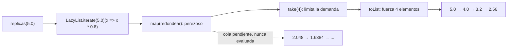

# Punto 4 — Réplicas perezosas

## 1. Informe de proceso

### Implementación

```scala
def replicas(magnitud: Double): LazyList[Double] = {
  def redondear(x: Double): Double = Math.round(x * 100.0) / 100.0
  LazyList.iterate(magnitud)(x => x * 0.8).map(redondear)
}

def replicasSensibles(magnitud: Double, minimo: Double): List[Double] =
  replicas(magnitud).takeWhile(_ > minimo).toList
```

La secuencia se genera con `LazyList.iterate`, que produce

$$
m,\; 0.8m,\; 0.8^2m,\; 0.8^3m,\ldots
$$

usando el valor **sin redondear** en cada paso. El redondeo se aplica después, con
`map`, al producir cada elemento visible. Así, el error de redondeo de un
elemento no se propaga al siguiente. `replicasSensibles` se apoya en `replicas` y
filtra con el valor ya redondeado mediante `takeWhile(_ > minimo)`.

### Traza de `replicas(5.0).take(4).toList`

1. `replicas(5.0)` construye una `LazyList` cuyo primer elemento es `5.0` y
   cuya cola es una expresión que todavía no se evalúa.
2. `map(redondear)` también es perezoso: no transforma nada hasta que alguien
   pida elementos.
3. `take(4)` construye otra secuencia perezosa que solo permitirá consumir
   cuatro elementos.
4. `toList` empieza a demandar elementos:
   - pide el primero: `5.0`, se redondea a `5.0`;
   - pide el siguiente: se evalúa `5.0 * 0.8 = 4.0`, se redondea a `4.0`;
   - pide el siguiente: `4.0 * 0.8 = 3.2`, se redondea a `3.2`;
   - pide el siguiente: `3.2 * 0.8 = 2.56`, se redondea a `2.56`.
5. Al completar los cuatro elementos, `take(4)` detiene la demanda. La cola que
   seguiría con `2.048`, `1.6384`, etc. nunca se evalúa.

| Paso | Valor exacto generado | Valor redondeado | ¿Se pide? |
|---|---:|---:|---|
| 0 | `5.0` | `5.0` | sí |
| 1 | `5.0 * 0.8 = 4.0` | `4.0` | sí |
| 2 | `4.0 * 0.8 = 3.2` | `3.2` | sí |
| 3 | `3.2 * 0.8 = 2.56` | `2.56` | sí |
| 4 | `2.56 * 0.8 = 2.048` | `2.05` | no |

El resultado es `List(5.0, 4.0, 3.2, 2.56)`.

### Traza de `replicasSensibles(5.0, 3.0)`

`replicasSensibles` toma `replicas(5.0)` y aplica `takeWhile(_ > 3.0)`, es decir,
conserva mientras el valor redondeado sea **estrictamente mayor** que `3.0`.
Después convierte a `List`.

| Paso | Valor redondeado | ¿`> 3.0`? | Acción |
|---|---:|---|---|
| 0 | `5.0` | sí | se conserva |
| 1 | `4.0` | sí | se conserva |
| 2 | `3.2` | sí | se conserva |
| 3 | `2.56` | no | se detiene el recorrido |

El resultado es `List(5.0, 4.0, 3.2)`. Para decidir que debe detenerse, el
recorrido evalúa el `2.56`, pero no lo incluye en la lista.

### Por qué una `LazyList` infinita no agota la memoria

Una `LazyList` representa su cola como un cálculo pendiente (*thunk*). Solo se
evalúa cuando se pide el elemento correspondiente, y una vez calculado se
memoiza para no repetir el trabajo. Por eso:

- `take(4)` y `take(1000)` solo fuerzan esa cantidad de elementos;
- `takeWhile` deja de forzar en cuanto encuentra el primer elemento que no cumple
  la condición;
- el resto de la secuencia infinita permanece como cálculos no ejecutados;
- no hay una lista infinita materializada, sino una cadena finita de elementos
  ya demandados y una cola pendiente.



La siguiente figura muestra el orden de la demanda: cada elemento se calcula solo
cuando el consumidor lo pide.

```mermaid
sequenceDiagram
    participant C as toList / take(4)
    participant L as LazyList
    C->>L: pedir elemento 0
    L-->>C: 5.0 (redondeado)
    C->>L: pedir elemento 1
    L-->>C: 4.0 (redondeado)
    C->>L: pedir elemento 2
    L-->>C: 3.2 (redondeado)
    C->>L: pedir elemento 3
    L-->>C: 2.56 (redondeado)
    Note over C,L: take(4) se detiene; la cola infinita queda sin evaluar
```

## 2. Informe de corrección

### Ecuación de recurrencia y forma cerrada

Sea $m$ la magnitud inicial. La secuencia exacta, antes de redondear, se define
por

$$
r_0 = m, \qquad r_{n+1} = 0.8\,r_n \quad \text{para } n \geq 0.
$$

**Proposición.** Para todo $n \geq 0$,

$$
r_n = m \cdot 0.8^n.
$$

**Demostración por inducción.**

- *Caso base* ($n = 0$):

  $$
  r_0 = m = m \cdot 0.8^0.
  $$

- *Paso inductivo.* Supóngase que $r_k = m \cdot 0.8^k$ para algún $k \geq 0$.
  Entonces, por la definición de la recurrencia y la hipótesis de inducción,

  $$
  r_{k+1} = 0.8\,r_k = 0.8\left(m \cdot 0.8^k\right)
          = m \cdot 0.8^{k+1}.
  $$

Por inducción, $r_n = m \cdot 0.8^n$ para todo $n \geq 0$. $\square$

### Monotonía estricta

Si $m > 0$, entonces $r_n = m \cdot 0.8^n > 0$ para todo $n$. Por lo tanto,

$$
r_{n+1} = 0.8\,r_n < r_n,
$$

pues $0 < 0.8 < 1$. La sucesión es estrictamente decreciente.

Además, como $0.8^n \to 0$ cuando $n \to \infty$, se tiene $r_n \to 0$. Por eso,
para cualquier mínimo positivo `minimo`, existe un primer índice $N$ tal que
$r_N \leq \text{minimo}$. La monotonía estricta garantiza que todos los términos
posteriores tampoco superan el mínimo. En consecuencia:

- `takeWhile(_ > minimo)` conserva exactamente el segmento inicial
  $r_0, r_1, \ldots, r_{N-1}$;
- el resultado no depende del orden de recorrido, porque el predicado se evalúa
  sobre una secuencia ya ordenada de mayor a menor;
- el recorrido siempre termina si $m > 0$ y `minimo` $> 0$;
- si $m \leq \text{minimo}$, la primera comparación falla y el resultado es
  `List()`.

Si `minimo` fuese cero o negativo, todos los términos positivos lo superarían y
`replicasSensibles` no terminaría; el uso previsto del taller toma mínimos
positivos. (Con `minimo = 0` la sucesión positiva nunca llega a cero.)

### Efecto del redondeo

La salida publicada es

$$
a_n = \operatorname{redondear2}(r_n)
    = \frac{\operatorname{Math.round}(100\,r_n)}{100}.
$$

El valor $r_n$ se genera sin redondear y solo se redondea al emitirse; por eso el
error no se acumula: cada $a_n$ depende de $r_n = m \cdot 0.8^n$, no de
$a_{n-1}$. Para valores no negativos,

$$
|a_n - r_n| \leq 0.005,
$$

es decir, a lo sumo medio centésimo. El redondeo es monótono, así que
$a_{n+1} \leq a_n$; sin embargo, en magnitudes muy pequeñas dos términos
consecutivos podrían redondearse al mismo valor. También puede mover el punto de
corte cuando el valor exacto cae justo alrededor del mínimo: la comparación se
hace con $a_n$, que es el valor realmente publicado. La decisión de diseño evita
que estos errores se amplifiquen a lo largo de la secuencia.

Finalmente, `replicasSensibles(m, minimo)` devuelve precisamente

$$
\bigl(a_0, a_1, \ldots, a_{N-1}\bigr)
\quad\text{donde}\quad
a_i > \text{minimo} \text{ para } i < N
\quad\text{y}\quad
a_N \leq \text{minimo},
$$

o `List()` si ya $a_0 = m \leq \text{minimo}$. Esto coincide con la
especificación: las réplicas que superan estrictamente el mínimo, incluida la
primera, con todos los valores redondeados a dos decimales.
